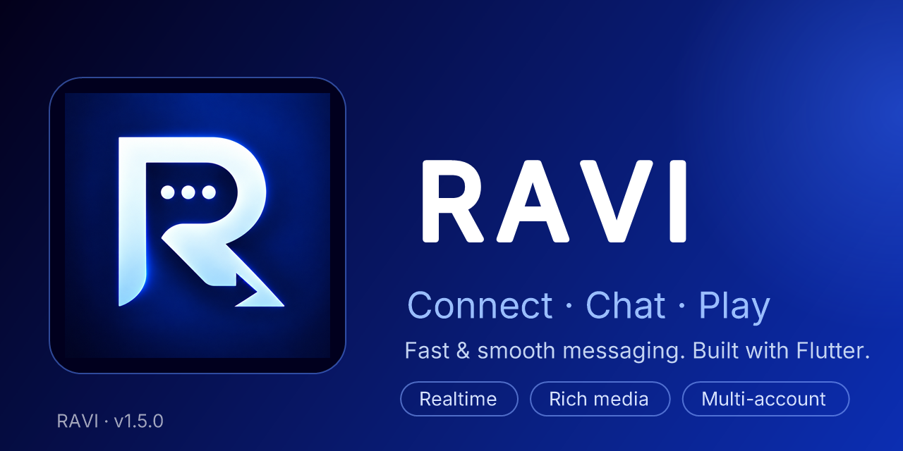

<div align="center">



[](/../../releases)
[](https://flutter.dev)
[](https://dart.dev)
[](https://socket.io)
[](LICENSE)

<br/>

[](#-english)
[](#-فارسی)

</div>

---

## 🇬🇧 English

**RAVI** — *Connect · Chat · Play* — a fast, smooth, cross-platform messenger built with **Flutter**: private chats, groups, public rooms and channels with **Socket.IO** realtime messaging, rich media, full theming and deep personalization.

### ✨ Features

- **💬 Realtime messaging** — private chats, groups, the public room and channels powered by **Socket.IO**: live typing indicators, read receipts, and unread badges/previews that update **without any refresh**.
- **📥 Smart media downloads** — photos & videos auto-download to a permanent on-disk cache (works offline afterwards); videos stream over HTTP Range even mid-download; circular progress rings, Telegram-style.
- **📎 File bubbles for every format** — zip / pdf / apk / docx / iso and more get per-format icons, the real file name, size, a progress ring and a delivery tick.
- **🎙 Audio & music** — voice messages and a built-in music player with a persistent player bar.
- **🏃 Reactions, swipe-to-reply, forward, delete, @mentions** — everything a modern chat needs.
- **📣 Channels** — admin-only posting with a clean, message-only channel view.
- **🖼 Avatar frames** — 7 fresh frames (Baroque, Butterfly, Gothic, Silver Stars, Stars Outline, Thorns, Wings), a live-preview frame picker, and a server-driven frame list (`GET /api/frames`) so new frames ship without an app update.
- **⭐ Animated PREMIUM badge** — the animated premium emblem plays on profiles (8s cycle) with a lightweight static version in lists.
- **🎨 Personalization** — light & dark themes, **8 live accent colors** that recolor the whole app instantly, selectable chat backgrounds, Vazirmatn & Inter typography (Fa/En).
- **👤 Multi-account** — switch between saved accounts right from the app.
- **🧹 Data & storage** — clear caches, manage downloads, global search across chats.
- **⚡ Performance-first** — cached list extents, constant list animations and clamping scroll physics keep it smooth on low-end phones.

### 🔌 Backend — "not connected by design"

> [!IMPORTANT]
> **This repository contains the RAVI *client* only.**
> It ships with **no backend** — straight after cloning and building, the app is **not connected to any server**. To run a fully working messenger you need to connect it to your own **RAVI-compatible backend**.

1. Set your server address in **`lib/core/constants.dart`**:

   ```dart
   const String kBaseUrl = '<your-backend-url>'; // e.g. 'http://localhost:5000'
   ```

2. A compatible backend must expose a small REST surface — auth/user (`/api/user`), sessions (`/api/sessions`), rooms (`/api/rooms`, `/api/room`), private chats (`/api/pv/…`), avatar frames (`/api/frames`) — plus the **Socket.IO** realtime layer (messages, typing, reads, reactions, room events).
3. The backend itself is **not part of this repository**; the client is fully server-agnostic and can be pointed at any compatible deployment.

### 🚀 Getting started

```bash
git clone https://github.com/XTeRMOFTHEM/ravi.git
cd ravi
flutter pub get
flutter run                 # run on a device/emulator
flutter build apk --release # release APK
```

> Requires Flutter SDK `^3.13.5` (Dart 3.13+). App icons are generated with `flutter_launcher_icons` from `assets/images/`; use your own keystore for release signing.

### 🗂 Project structure

```
lib/
├── main.dart                     # Entrypoint
├── ravi_app.dart                 # Root widget — theme & locale wiring
├── core/
│   ├── api_service.dart          # REST client (auth, rooms, chats, media, frames)
│   ├── socket_service.dart       # Socket.IO realtime layer
│   ├── chat_controller.dart      # Chat state machine
│   ├── app_state.dart            # Session, language & preferences
│   ├── account_manager.dart      # Multi-account store
│   ├── media_download_manager.dart # Smart media downloads w/ progress
│   ├── audio_cache_service.dart  # Permanent audio cache
│   ├── storage_service.dart      # Permanent on-disk media store
│   ├── player_service.dart       # Audio playback
│   ├── chat_bg.dart              # Chat backgrounds
│   ├── i18n.dart                 # English / Persian strings
│   └── constants.dart            # Design tokens, palettes, kBaseUrl
└── ui/
    ├── splash_screen.dart
    ├── auth/auth_screen.dart
    ├── chat/                     # chat screen, bubbles, previews, player bar…
    ├── home/                     # chats, profile, settings, group info…
    └── widgets/                  # premium badge, alerts, common widgets
```

---

## 🇮🇷 فارسی

<div dir="rtl" align="right">

**راوی** — *ارتباط · چت · بازی* — یک پیام‌رسان سریع و روانِ چندسکویی ساخته‌شده با **فلاتر**: چت خصوصی، گروه، اتاق عمومی و کانال‌ها با پیام‌رسانی لحظه‌ایِ Socket.IO، رسانه‌ی کامل، تم‌بندی و شخصی‌سازی عمیق.

### ✨ امکانات

- **💬 پیام‌رسانی لحظه‌ای** — چت خصوصی، گروه، اتاق عمومی و کانال‌ها روی **Socket.IO**: تایپِ زنده، تیک خوانده‌شدن، و بج‌ها و پیش‌نمایش‌های ناخوانده که **بدون هیچ رفرشی** به‌روز می‌شوند.
- **📥 دانلود هوشمند رسانه** — عکس و ویدئو خودکار دانلود و برای همیشه روی دیسک ذخیره می‌شوند (بعدش بدون اینترنت هم پخش می‌شود)؛ ویدئو حتی حین دانلود با HTTP Range استریم می‌شود؛ حلقه‌ی پیشرفت دایره‌ای، به سبک تلگرام.
- **📎 حباب فایل برای هر فرمتی** — zip / pdf / apk / docx / iso و… آیکون مخصوص فرمت، نام و حجم واقعی، حلقه‌ی درصد و تیکِ تحویل.
- **🎙 صدا و موسیقی** — ویس، پخش‌کننده‌ی موسیقی داخلی با نوار پخشِ ماندگار.
- **🏃 ری‌اکشن، ریپلای با سوایپ، فوروارد، حذف، منشن (@)** — همه‌چیزِ یک چت مدرن.
- **📣 کانال‌ها** — ارسال فقط برای ادمین‌ها و نمای تمیزِ «فقط پیام».
- **🖼 قاب آواتار** — ۷ قاب جدید (باروک، پروانه، گوتیک، ستاره‌های نقره‌ای، ستاره‌های خطی، خارها، بال‌ها)، فریم‌پیکر با **پیش‌نمایش زنده**، و لیست قاب‌ها مستقیم از سرور (`GET /api/frames`) — قاب جدید = بدون آپدیت اپ.
- **⭐ بج انیمیشنی PREMIUM** — روی پروفایل‌ها با چرخه‌ی ۸ ثانیه، و در لیست‌ها نسخه‌ی ثابتِ سبک.
- **🎨 شخصی‌سازی** — تم روشن/تاریک، **۸ رنگ اکسنتِ زنده** که تمام اپ را لحظه‌ای عوض می‌کنند، پس‌زمینه‌های انتخابی چت، فونت‌های وزیرمتن و Inter (فا/ان).
- **👤 چندحسابی** — جابه‌جایی سریع بین حساب‌های ذخیره‌شده از خود اپ.
- **🧹 داده و حافظه** — پاک‌سازی کش‌ها، مدیریت دانلودها، جست‌وجوی سراسری.
- **⚡ اولویت پرفورمنس** — کشِ گستره‌ی لیست‌ها، انیمیشن ثابت ردیف‌ها و فیزیک Clamping برای نرمی روی گوشی‌های ضعیف.

### 🔌 بک‌اند — «عمداً وصل نیست»

> [!IMPORTANT]
> **این ریپو فقط «کلاینت» راوی است.**
> **هیچ بک‌اندی همراهش منتشر نمی‌شود** — بلافاصله بعد از کلون و بیلد، اپ **به هیچ سروری وصل نیست**. برای اجرای یک چت واقعاً زنده باید آن را به یک **بک‌اندِ سازگارِ راوی** وصل کنید.

1. آدرس سرور را در **`lib/core/constants.dart`** تنظیم کنید:

   ```dart
   const String kBaseUrl = '<your-backend-url>'; // مثلاً 'http://localhost:5000'
   ```

2. یک بک‌اند سازگار یک رستِ کوچک ارائه می‌دهد — احراز هویت و کاربر (`/api/user`)، نشست‌ها (`/api/sessions`)، اتاق‌ها (`/api/rooms`، `/api/room`)، چت خصوصی (`/api/pv/…`)، قاب‌ها (`/api/frames`) — به‌علاوه‌ی لایه‌ی لحظه‌ایِ **Socket.IO** (پیام، تایپ، خوانده‌شده، ری‌اکشن، ایونت‌های اتاق).
3. کد بک‌اند در این ریپو **نیست**؛ کلاینت کاملاً سرور-مستقل است و به هر استقرارِ سازگاری وصل می‌شود.

### 🚀 شروع کار

```bash
git clone https://github.com/XTeRMOFTHEM/ravi.git
cd ravi
flutter pub get
flutter run                  # اجرا روی گوشی/شبیه‌ساز
flutter build apk --release  # خروجی نهایی
```

> به Flutter SDK `^3.13.5` نگهش دارید (Dart 3.13+). آیکون‌های اپ با `flutter_launcher_icons` از `assets/images/` ساخته می‌شوند؛ برای امضای ریلیز از keystore خودتان استفاده کنید.

### 🗂 ساختار پروژه

```
lib/
├── main.dart                     # نقطه شروع
├── ravi_app.dart                 # ریشه‌ی اپ — تم و زبان
├── core/
│   ├── api_service.dart          # کلاینت REST (ورود، اتاق‌ها، چت، رسانه، قاب‌ها)
│   ├── socket_service.dart       # لایه‌ی لحظه‌ای Socket.IO
│   ├── chat_controller.dart      # ماشین حالت چت
│   ├── app_state.dart            # نشست، زبان و تنظیمات
│   ├── account_manager.dart      # چندحسابی
│   ├── media_download_manager.dart # دانلود هوشمند رسانه با پیشرفت
│   ├── audio_cache_service.dart  # کش دائمی صدا
│   ├── storage_service.dart      # حافظه‌ی دائمی مدیا روی دیسک
│   ├── player_service.dart       # پخش صدا
│   ├── chat_bg.dart              # پس‌زمینه‌های چت
│   ├── i18n.dart                 # متن‌های انگلیسی / فارسی
│   └── constants.dart            # توکن‌های طراحی، پالت‌ها و kBaseUrl
└── ui/
    ├── splash_screen.dart
    ├── auth/auth_screen.dart
    ├── chat/                     # صفحه چت، حباب‌ها، پیش‌نمایش‌ها، نوار پخش…
    ├── home/                     # چت‌ها، پروفایل، تنظیمات، اطلاعات گروه…
    └── widgets/                  # بج پرمیوم، هشدارها، ویجت‌های مشترک
```

</div>

---

<div align="center">

**RAVI v1.5.0** · Built with 💙 · MIT licensed — see [LICENSE](LICENSE)

</div>
