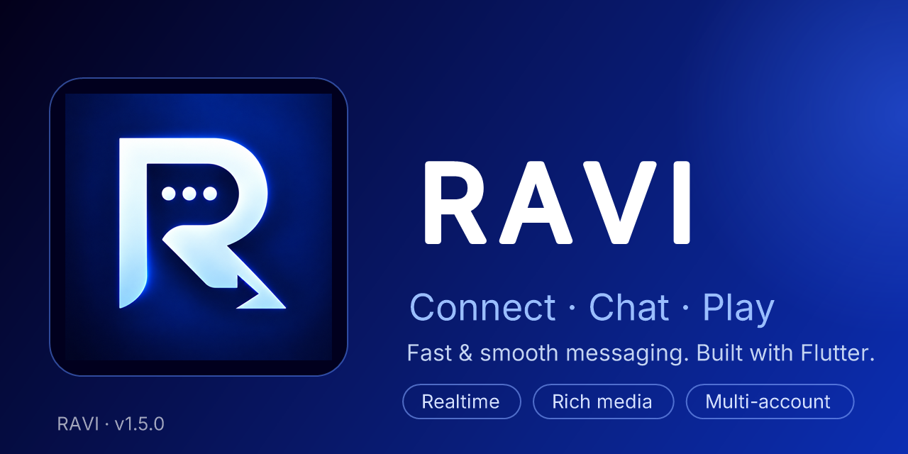

<div align="center">



[](/../../releases)
[](https://flutter.dev)
[](https://dart.dev)
[](https://socket.io)
[](backend)
[](LICENSE)

</div>

---

**RAVI** — *Connect · Chat · Play* — a fast, smooth, cross-platform messenger built with **Flutter**: private chats, groups, public rooms and channels with **Socket.IO** realtime messaging, rich media, full theming and deep personalization.

## Features

###  Realtime messaging
Private chats, groups, the public room and channels powered by **Socket.IO**: live typing indicators, read receipts, and unread badges/previews that update **without any refresh**.

###  Smart media downloads
Photos and videos auto-download to a permanent on-disk cache (works offline afterwards); videos stream over HTTP Range even mid-download; circular progress rings, Telegram-style.

###  File bubbles for every format
zip / pdf / apk / docx / iso and more get per-format icons, the real file name, size, a progress ring and a delivery tick.

###  Audio and music
Voice messages and a built-in music player with a persistent player bar.

###  Modern chat tooling
Reactions, swipe-to-reply, forward, delete and @mentions — everything a modern chat needs.

###  Channels
Admin-only posting with a clean, message-only channel view and live view counters.

###  Avatar frames
7 frames (Baroque, Butterfly, Gothic, Silver Stars, Stars Outline, Thorns, Wings), a live-preview frame picker, and a server-driven frame list (`GET /api/frames`) so new frames ship without an app update.

###  Animated PREMIUM badge
The animated premium emblem plays on profiles (8s cycle) with a lightweight static version in lists.

###  Personalization
Light and dark themes, **8 live accent colors** that recolor the whole app instantly, selectable chat backgrounds, Vazirmatn and Inter typography (Fa/En).

###  Multi-account
Switch between saved accounts right from the app.

###  Data and storage
Clear caches, manage downloads, global search across chats.

###  Performance-first
Cached list extents, constant list animations and clamping scroll physics keep it smooth on low-end phones.

## Backend

> [!NOTE]
> This repository ships the RAVI **client**, and the app builds **not connected** by default — straight after cloning, `kBaseUrl` points nowhere. To run a fully working messenger you connect it to a **RAVI-compatible backend**.

1. Set your server address in **`lib/core/constants.dart`**:

   ```dart
   const String kBaseUrl = '<your-backend-url>'; // e.g. 'http://localhost:5000'
   ```

2. **A ready-to-run RAVI backend lives in this repository** — see [`backend/`](backend) and its [README](backend/README.md) for the fast/quick run guide (`pip install -r requirements.txt && python app.py`).
3. The backend exposes a small REST surface — auth/user (`/api/user`), sessions (`/api/sessions`), rooms (`/api/rooms`, `/api/room`), private chats (`/api/pv/…`), avatar frames (`/api/frames`) — plus the **Socket.IO** realtime layer (messages, typing, reads, reactions, room events). The client is server-agnostic and can be pointed at any compatible deployment.

## Getting started

```bash
git clone https://github.com/XTeRMOFTHEM/ravi.git
cd ravi
flutter pub get
flutter run                 # run on a device/emulator
flutter build apk --release # release APK
```

> Requires Flutter SDK `3.44+` (Dart `3.13+`). App icons are generated with `flutter_launcher_icons` from `assets/images/`; use your own keystore for release signing.

## Project structure

```
lib/
├── main.dart                     # Entrypoint
├── ravi_app.dart                 # Root widget — theme and locale wiring
├── core/
│   ├── api_service.dart          # REST client (auth, rooms, chats, media, frames)
│   ├── socket_service.dart       # Socket.IO realtime layer
│   ├── chat_controller.dart      # Chat state machine
│   ├── app_state.dart            # Session, language and preferences
│   ├── account_manager.dart      # Multi-account store
│   ├── media_download_manager.dart # Smart media downloads w/ progress
│   ├── audio_cache_service.dart  # Permanent audio cache
│   ├── storage_service.dart      # Permanent on-disk media store
│   ├── player_service.dart       # Audio playback
│   ├── chat_bg.dart              # Chat backgrounds
│   ├── i18n.dart                 # English / Persian strings
│   └── constants.dart            # Design tokens, palettes, kBaseUrl
└── ui/
    ├── splash_screen.dart
    ├── auth/auth_screen.dart
    ├── chat/                     # chat screen, bubbles, previews, player bar…
    ├── home/                     # chats, profile, settings, group info…
    └── widgets/                  # premium badge, alerts, common widgets
```

---

<div align="center">

**RAVI v1.5.1** · MIT licensed — see [LICENSE](LICENSE)

</div>
